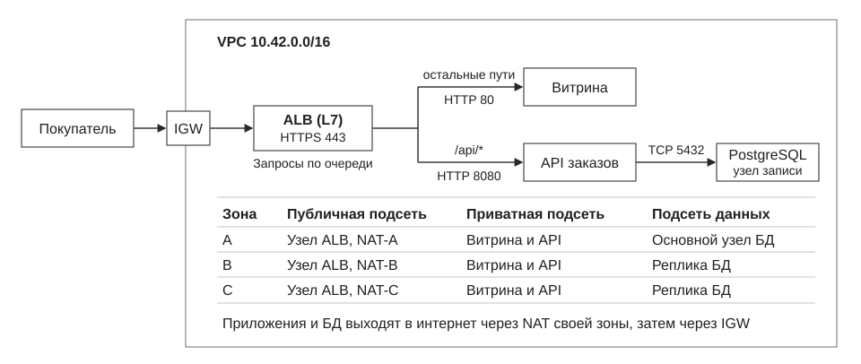

# Работа 1. Облачная сеть книжного интернет-магазина

Магазин продает печатные книги в Санкт-Петербурге и области. Покупатель смотрит каталог, оформляет заказ и проверяет его статус.

| Компонент | Что делает | Откуда получает запросы |
| --- | --- | --- |
| Витрина | Показывает каталог и форму заказа | От балансировщика |
| API заказов | Принимает заказы, читает их статус в PostgreSQL | От балансировщика по путям `/api/*` |
| PostgreSQL | Хранит сведения о книгах и заказах | Только от API |

## 1. Обоснование CIDR

Для VPC выбран диапазон `10.42.0.0/16`. Для сети офиса взят диапазон `10.10.0.0/16`, поэтому пересечения нет. Из /16 можно выделить 256 подсетей /24. Девять нужны магазину, остальные остаются в запасе.

## 2. Таблица подсетей

В каждой зоне по три подсети. Во всех девяти есть локальный маршрут к `10.42.0.0/16`. В таблице указан маршрут по умолчанию `0.0.0.0/0`.

| Зона | Подсеть | CIDR | Тип | Маршрут по умолчанию |
| --- | --- | --- | --- | --- |
| A | public-A | 10.42.11.0/24 | Публичная | IGW |
| A | application-A | 10.42.12.0/24 | Приватная | NAT-A |
| A | data-A | 10.42.13.0/24 | Приватная | NAT-A |
| B | public-B | 10.42.21.0/24 | Публичная | IGW |
| B | application-B | 10.42.22.0/24 | Приватная | NAT-B |
| B | data-B | 10.42.23.0/24 | Приватная | NAT-B |
| C | public-C | 10.42.31.0/24 | Публичная | IGW |
| C | application-C | 10.42.32.0/24 | Приватная | NAT-C |
| C | data-C | 10.42.33.0/24 | Приватная | NAT-C |

## 3. Схема сети

При оформлении заказа браузер обращается к `/api/orders`. ALB передает запрос в API, а API записывает заказ через внутренний адрес PostgreSQL.

## 4. Балансировщики

Один публичный ALB работает в трех зонах и принимает HTTPS на порту 443 с сертификатом магазина. Выбран ALB, потому что он читает путь HTTP-запроса и может направить его в нужную группу серверов.

| Сервис | Тип | Уровень | Правило | Стратегия |
| --- | --- | --- | --- | --- |
| API заказов | ALB | L7 | `/api/*` на порт 8080 | Round robin |
| Витрина | ALB | L7 | Остальные пути на порт 80 | Round robin |

В каждой группе одинаковые серверы без состояния сеанса, поэтому ALB распределяет запросы по очереди. Раз в 15 с он проверяет `GET /health` и ждет HTTP 200 до 5 с. После двух неудачных проверок ALB перестает отправлять запросы на сервер. После двух успешных снова его использует.

## 5. Связность и резервирование

Публичные подсети выходят в интернет через IGW. В каждой зоне свой NAT-шлюз с публичным адресом. Через него приложения и БД могут сами открывать исходящие соединения, например для обновлений по HTTPS. Публичных адресов у этих серверов нет.

Витрина и API работают в каждой зоне. PostgreSQL размещен в подсетях данных. В зоне A основной узел, в B и C по реплике. Если зона A отключится, ALB продолжит направлять запросы в B и C. Кластер назначит одну из реплик основным узлом. API заново подключится по прежнему адресу записи. NAT-шлюзы оставшихся зон продолжат работать.

Для подключения офиса к VPC предусмотрен Direct Connect. Резервный Site-to-Site VPN использует два туннеля, другого провайдера и отдельное оборудование офиса. Маршруты передаются по BGP. При потере маршрута через Direct Connect трафик пойдет через VPN.

## 6. Безопасность и журналы соединений

Группы безопасности пропускают ответы по уже открытым соединениям. Правила ниже относятся к трафику приложения. Репликацией управляет сервис базы данных.

| Группа | Входящие соединения | Исходящие соединения |
| --- | --- | --- |
| ALB | TCP 443 из интернета | TCP 80 к витрине и TCP 8080 к API |
| Витрина | TCP 80 от ALB | TCP 443 через NAT для обновлений |
| API | TCP 8080 от ALB | TCP 5432 к базе и TCP 443 через NAT для обновлений |
| База данных | TCP 5432 от API | HTTPS при необходимости обслуживания |

У NAT Gateway в AWS нет своей группы безопасности. Исходящий трафик ограничивает группа сервера. Если нужен ACL на границе подсети, в нем отдельно учитывают порты для ответа.

VPC Flow Logs передает записи о принятых и отклоненных соединениях в CloudWatch Logs. Если API не подключается к базе, ищем исходный адрес API, порт 5432 и пометку `REJECT`. Ошибку самого SQL-запроса ищем в журнале PostgreSQL.

## 7. Выводы

Сеть рассчитана на отказ одной зоны. Две другие сохранят копии приложения и выход в интернет. При смене основного узла PostgreSQL отдельные заказы могут завершиться ошибкой, пока API переподключается.

### Контрольные вопросы

1. **Чем VXLAN отличается от VLAN?** У VLAN 12 бит для идентификатора. VXLAN переносит кадры поверх IP по UDP и использует 24 бита, поэтому сегментов может быть больше.
2. **Что выбрать для gRPC и WebSocket?** ALB поддерживает gRPC по HTTP/2 и переключение соединения на WebSocket. NLB работает на уровне TCP и подходит, если шифрованное соединение нужно передать до сервера.
3. **Зачем задавать время жизни кеша?** Без явных указаний CDN может применить свои настройки. TTL задает срок хранения ответа. Для персональных ответов API общий кеш лучше ограничить или отключить.
4. **Сколько NAT-шлюзов нужно?** Три, по одному на зону. Сбой в одной зоне тогда не отрежет две другие от интернета.
5. **Чем группа безопасности отличается от ACL?** Группа задает разрешения на уровне ресурса и учитывает состояние соединения. ACL действует на уровне подсети. Он проверяет правила по порядку, может явно запретить трафик и отдельно проверяет ответы.
6. **Почему база в приватной подсети?** К базе подключается только API. Публичный адрес PostgreSQL не нужен.
7. **Для чего нужны Flow Logs?** В них видны адреса, порты и решение о допуске. По этим записям можно найти блокировку или неожиданное соединение.

# Работа 2. Мониторинг API заказов

На стенде вызвали ошибку заказа, задержку и всплеск запросов. В Grafana проверили метрики Prometheus и журнал из Loki.

API вернул HTTP 503. По `trace_id` из журнала тот же запрос нашли в Jaeger. В медленном запросе из 2,001 с этап `slow-dependency` занял 2,000 с. Сработали все три правила Prometheus. Alertmanager отправил уведомления локальному получателю.

[Запуск, пороги оповещений и пять скриншотов](lab-2/README.md)
